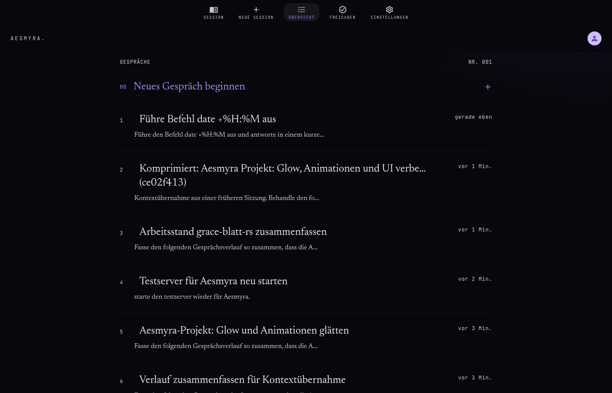
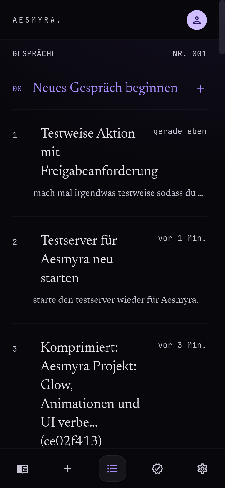
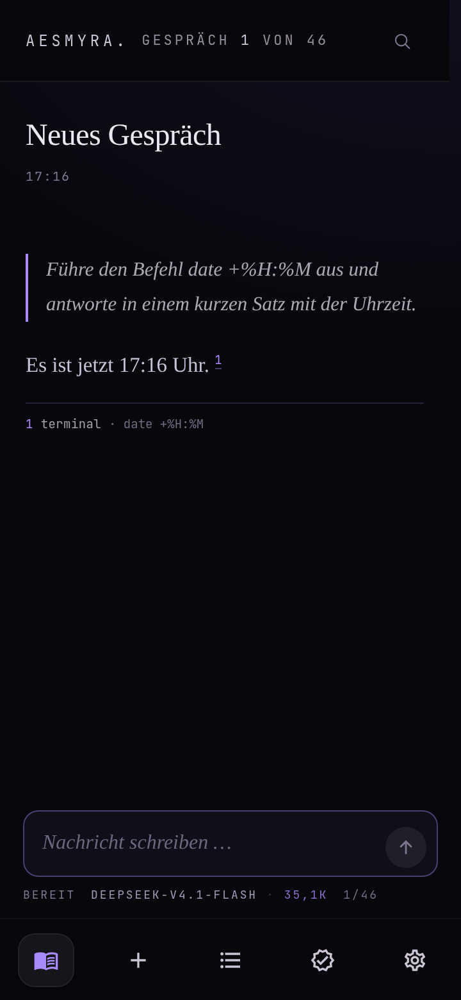
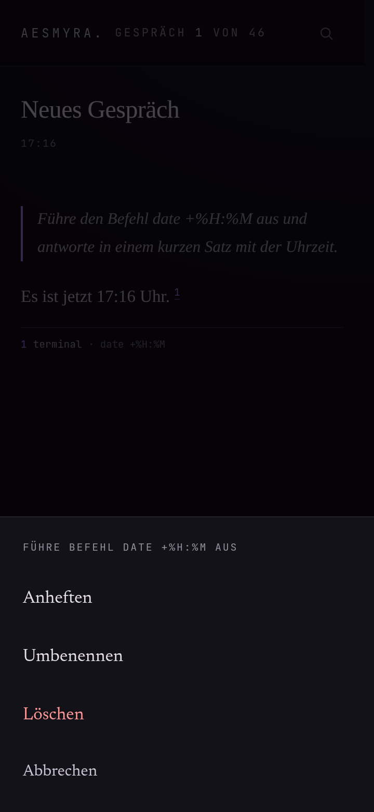
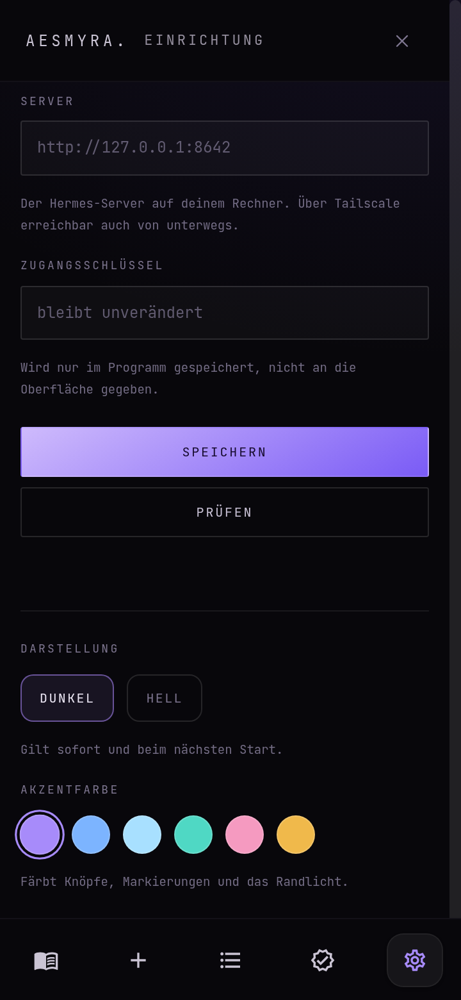

# Aesmyra.

**Hermes-Gespräche in einer fortlaufenden Übersicht — für Windows, Linux und Android.**


[Projektseite](https://feisty-38.github.io/Aesmyra/) · [Repository](https://github.com/Feisty-38/Aesmyra)

> ## Alpha — es gibt noch keine stabilen Releases
>
> Aesmyra steckt in einer frühen Phase. **Jeder Build, den du heute bekommst, ist ein Alpha-Build.** Das heißt konkret:
>
> - Funktionsumfang, Bedienung und Tastenkürzel ändern sich ohne Vorankündigung.
> - Konfigurationsdatei und Datenformate können sich verschieben, ohne dass alte Stände übernommen werden.
> - Es gibt keinen Auto-Updater: neue Stände müssen von Hand installiert werden.
> - Windows-Installer sind nicht signiert (SmartScreen-Warnung), Android-APKs sind Debug-Builds.
> - Die Oberfläche ist derzeit nur auf Deutsch.
>
> Wer eine stabile Oberfläche braucht, wartet besser auf die erste Beta. Fehlerberichte sind trotzdem willkommen — sie sind in dieser Phase am wertvollsten.

## Was ist Aesmyra?

Aesmyra ist eine eigenständige Oberfläche für [Hermes Agent](https://hermes-agent.nousresearch.com/). Statt eines endlosen Chatfensters zeigt Aesmyra eine fortlaufende Übersicht: Jede Sitzung wird ein Gespräch, durchnummeriert, mit Vorschau und Zeitangabe. Werkzeugaufrufe erscheinen als schmale Notizen, Denkschritte als kursive Einschübe, Freigaben als Kasten mitten im Text. Wer lange mit einem Assistenten arbeitet, soll den Faden behalten — nicht in einer Liste aus Sprechblasen suchen.

Der Client spricht ausschließlich mit dem Hermes-API-Server auf dem eigenen Rechner oder im eigenen Netz (Standard `http://127.0.0.1:8642`), per HTTP und SSE. Kein Cloud-Dienst dazwischen, keine Konten, keine Telemetrie.

Technisch ist Aesmyra eine Tauri-2-Anwendung: ein Rust-Kern für Netzwerk, Verlauf und Konfiguration, darüber eine Oberfläche aus HTML, CSS und ES2020 — ohne Framework, ohne Bundler, ohne Build-Schritt für das Frontend.

## Bilder



| Übersicht auf Android | Gesprächsansicht |
| --- | --- |
|  |  |

| Gesprächs-Aktionen | Einrichtung |
| --- | --- |
|  |  |

## Funktionen

### Übersicht

- **Gespräche statt Chats:** jede Sitzung als Eintrag mit laufender Nummer, Titel, Vorschau und relativer Zeitangabe.
- **Angeheftete Gespräche** stehen oben und sind mit einem Punkt markiert.
- **Langes Tippen oder Rechtsklick** öffnet die Aktionen: anheften, umbenennen, löschen.
- **Nummer** oben rechts (`Nr. 006`) zeigt die Stelle in der Übersicht.

### Gesprächsansicht

- **Markdown** mit Überschriften, Listen, Tabellen, Code und Fußnoten.
- **Notizen:** jeder Werkzeugaufruf erscheint als schmale Zeile mit Name und Kurzfassung der Argumente, aufklappbar bis zur vollständigen Ausgabe.
- **Denknotizen** werden als kursive, abgesetzte Absätze gezeigt — sichtbar, aber nicht im Weg.
- **Live-Abschnitt** während eines Laufs; die Statuszeile nennt den Zustand (bereit, läuft, getrennt, neu verbunden).
- **Freigabekasten** direkt im Text, wenn ein Werkzeug auf Erlaubnis wartet.
- **Suche im Gespräch** mit Trefferzahl und Sprung zwischen den Fundstellen.
- **Scrollposition** wird je Gespräch gemerkt; Blättern über die Punkte am Fuß oder mit `Alt` + Pfeiltasten.

### Freigaben

- Sammelansicht aller offenen Anfragen mit Anzahl in der Leiste.
- Entscheidung als **einmal**, **diese Sitzung**, **immer** oder **ablehnen**; die Wahl geht an den laufenden Auftrag zurück.
- Entschiedene Anfragen bleiben sichtbar, solange der Lauf läuft.

### Einrichtung

- **Serveradresse** frei wählbar (Standard `http://127.0.0.1:8642`), erreichbar lokal, im LAN oder über Tailscale.
- **Zugangsschlüssel** wird nur im Rust-Prozess gehalten und mit Rechten `0600` gespeichert. Die Oberfläche erfährt nur, *ob* ein Schlüssel hinterlegt ist, plus die letzten vier Zeichen.
- **Prüfen** testet die Verbindung, ohne die Einstellungen zu speichern.
- Liegt kein Schlüssel in der Konfiguration, liest der Client `API_SERVER_KEY` aus `~/.hermes/.env`.

### Plattformen

- **Linux:** `.deb` und AppImage; auf Systemen mit NVIDIA-Treiber wird der DMA-BUF-Renderer von WebKitGTK automatisch abgeschaltet, damit das Fenster nicht schwarz bleibt.
- **Windows:** MSI und NSIS-Setup, gebaut auf einem echten Windows-Runner.
- **Android:** APK, gebaut mit dem Tauri-Android-Werkzeug.

## Status im Detail

| Plattform | Paket | Stand |
| --- | --- | --- |
| Linux | `.deb`, AppImage | Alpha, lokal baubar |
| Windows | MSI, NSIS | Alpha, CI-Build |
| Android | APK (Debug) | Alpha, Emulator und Gerät |
| Releases | — | **noch keine** |

## Voraussetzungen

- **Hermes Agent** mit aktivem API-Server. Ohne laufenden Server zeigt Aesmyra nur die Einrichtung.
- **Zugangsschlüssel** (`API_SERVER_KEY`), entweder in `~/.hermes/.env` oder in der Einrichtung eingetragen.
- **Erreichbarkeit** des Servers: lokal über `127.0.0.1`, im Heimnetz über die LAN-Adresse, von unterwegs über Tailscale.

## Bauen

> Der Quelltext liegt vollständig im Repository. Die folgenden Schritte beschreiben den Bau auf der jeweiligen Plattform.

<details>
<summary>Linux</summary>

Benötigt: Rust (stable), Node.js ab 18, WebKitGTK 4.1, GTK 3, librsvg und libayatana-appindicator (Paketnamen je Distribution).

```bash
git clone https://github.com/Feisty-38/Aesmyra.git aesmyra
cd aesmyra
npm install
cd crates/aesmyra-app
../../node_modules/.bin/tauri build
```

Die Pakete landen unter `target/release/bundle/deb/` und `target/release/bundle/appimage/`.

</details>

<details>
<summary>Windows</summary>

Benötigt: Visual Studio 2022 Build Tools mit „Desktop development with C++“, Rust stable (MSVC), WebView2-Runtime und Node.js LTS.

```powershell
npm install
cd crates\aesmyra-app
..\..\node_modules\.bin\tauri build --bundles "msi,nsis" --ci
```

Ohne `--bundles` würde die CLI die Linux-Ziele aus der Konfiguration bauen wollen. Der CI-Weg steht in `.github/workflows/build.yml`: Actions → **Windows-Build** → Artefakt `aesmyra-windows-x64`.

</details>

<details>
<summary>Android</summary>

Benötigt: JDK 17, Android SDK und NDK, die Rust-Ziele für Android sowie `cargo-ndk`.

```bash
npx tauri android init          # einmalig
npx tauri android build --debug --apk
```

Auf Android liegt die Konfiguration unter `/data/user/0/dev.grace.aesmyra/config.json` — nicht unter `files/`. Der Pfad wird beim Start gesetzt, bevor die Konfiguration geladen wird.

</details>

## Architektur

```text
+-------------------------------+
| ui/  HTML + CSS + ES2020      |  kein Bundler, kein Netzwerkzugriff
+---------------+---------------+
                | invoke / Channel (Tauri-IPC)
+---------------v---------------+
| crates/aesmyra-app            |  Befehle, Laufverwaltung, Freigaben
+---------------+---------------+
                |
+---------------v---------------+
| crates/aesmyra-core           |  HTTP, SSE, Verlauf, Konfiguration
+---------------+---------------+
                | HTTP + SSE
+---------------v---------------+
| Hermes-API, 127.0.0.1:8642    |
+-------------------------------+
```

| Pfad | Inhalt |
| --- | --- |
| `crates/aesmyra-core` | Hermes-API, Ereignisstrom, Verlaufsaufbereitung, Konfiguration |
| `crates/aesmyra-app` | Tauri-Befehle, Laufverwaltung, Fenster, Plattform-Anpassungen |
| `ui/` | `index.html`, `aesmyra.css`, `app.js` — reines ES2020 |
| `.github/workflows/build.yml` | Windows-Build für MSI und NSIS |

Die Oberfläche kennt 14 Befehle (`settings_get`, `sessions_list`, `chat_start`, `run_approve` und weitere) und bekommt den Lauf über einen Kanal als Ereignisstrom: `delta`, `commentary`, `tool_started`, `tool_finished`, `approval`, `completed`, `failed`, `cancelled`, `reconnecting`, `recovered`, `finished`.

## Sicherheit und Datenschutz

- Der Zugangsschlüssel verlässt den Rust-Prozess nicht; die Oberfläche bekommt nur einen Hinweis auf die letzten vier Zeichen.
- Die Oberfläche hat keinen eigenen Netzwerkzugriff: kein `fetch`, kein `XMLHttpRequest`, kein Netzzugriff aus `localStorage`. Alles läuft über Tauri-Befehle.
- Strikte Content-Security-Policy: `default-src 'self'`, keine Inline-Skripte, keine Ressourcen von außen.
- Externe Links öffnet nur das System, und nur nach Prüfung auf `http`/`https`.
- Keine Telemetrie, keine Konten, kein Cloud-Dienst.

## Tastenkürzel

| Taste | Wirkung |
| --- | --- |
| `Esc` | Suche, Einrichtung oder Aktionsmenü schließen |
| `Strg` + `,` | Einrichtung öffnen |
| `Strg` + `K` | Übersicht anzeigen |
| `Alt` + `←` / `→` | voriges / nächstes Gespräch |

## Bekannte Grenzen

- Die Oberfläche ist nur auf Deutsch.
- Kein Auto-Updater, keine Signatur, keine automatischen Releases.
- Sehr lange Gespräche werden vollständig geladen; eine schrittweise Nachladung gibt es noch nicht.
- Die Nummerierung richtet sich nach der Liste der Sitzungen und verschiebt sich, wenn neue Sitzungen dazukommen.

## Mitmachen

Fehler und Wünsche gehören als Issue ins Repository, am besten mit Betriebssystem, Aesmyra-Version, Schritten zur Reproduktion und einem Auszug aus der Ausgabe auf `stderr`. In der Alpha gibt es keine Stabilitätszusagen; kleine, begründete Änderungen sind willkommen.

## Lizenz

MIT — siehe [LICENSE](LICENSE).

## Danksagung

- [Hermes Agent](https://hermes-agent.nousresearch.com/) von Nous Research für API und Ereignisprotokoll
- [Tauri](https://tauri.app) für das Fenster und die Bindung zwischen Rust und Oberfläche
- Die Schriften **Newsreader** und **JetBrains Mono** unter der SIL Open Font License
